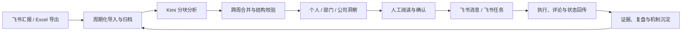

# 亿觅成长 OS

> 把周报从一次性的“汇报动作”，变成个人成长轨迹、组织问题雷达和现实任务闭环。

[](https://github.com/brotherjean/emie-growth-os/actions)


[](LICENSE)

亿觅成长 OS（EMIE Growth OS）是一套围绕**周报、成长分析、管理注意力排序和任务闭环**构建的 AI 原生组织工作系统。它读取飞书汇报或 Excel 导出数据，将分散的工作记录组织成可追溯的周期上下文，再通过 AI 分析、人工确认、飞书任务与提醒，把“发现问题”推进到“完成行动、验证结果、沉淀机制”。

它最初源于一个真实的管理问题：扁平组织里，老板很难每周完整阅读数十份周报、记住跨周承诺，并判断哪些事项真正需要自己介入。系统因此不以“生成更多点评”为目标，而以**帮助管理者排序注意力、帮助员工看见成长、帮助组织持续完成闭环**为核心。

> **公开仓库说明**：本仓库只包含代码、匿名演示数据和脱敏截图。真实员工身份、周报正文、AI 分析、互动记录、SQLite 数据库、上传文件、API Key 与部署凭据均不进入 Git。

## 项目价值

### 对员工：看见自己的成长轨迹

- 回看每周周报、评分趋势、能力变化与历史承诺。
- 获得以鼓励为主的 AI 点评、教练式提问和成长建议。
- 对照“上周计划 -> 本周证据”，判断任务是否真正闭环。
- 把模糊问题拆成可编辑、可执行、可验证的任务候选。

### 对管理者：只看真正需要介入的事情

- 从数十份周报中识别 P0/P1 风险、跨部门阻塞和必须完整阅读的报告。
- 按部门和周期观察重复问题、闭环进展、协同关系与机制沉淀。
- 将员工单靠个人努力难以推动的事项汇入管理注意力队列。
- 生成公司总结草稿，在人工编辑确认后通过飞书触达团队。

### 对组织：把互动沉淀为下一次分析的上下文

- 周报、评论、追问、任务状态和协同评分共同构成组织记忆。
- 任务创建不是终点；问题被解决并形成可复用机制才算闭环。
- 周会、月会可以从结论跳回事实依据，持续比较跨周、跨月变化。
- 在控制权限和保留人工判断的前提下，让 AI 逐步理解现实约束。

## 产品演示

演示环境使用虚构员工与匿名内容，不连接真实飞书，也不会发送消息或创建任务。

### 老板驾驶舱：管理注意力排序


老板驾驶舱把公司级结论、需要拍板的问题、跨部门协调、必读周报和可发送总结放在同一个决策工作区。管理者不需要逐份翻阅全部文本，而是先处理最重要的少数问题，再下钻查看证据。

### 个人成长：从周报评分到跨周闭环


个人页同时保留长期成长趋势与当周行动：历史周报和评分用于观察变化，当周 AI 提问、任务候选和协同反馈用于推动下一步。员工可以看到自己说过什么、做到了什么，以及哪些问题仍在重复出现。

## 主要功能

| 模块 | 解决的问题 | 当前能力 |
|---|---|---|
| 个人成长 | 周报写完即消失，员工看不到长期变化 | 历史周报、评分趋势、成长雷达、AI 点评、教练提问、承诺闭环 |
| 老板驾驶舱 | 信息过载，重要事项淹没在周报正文中 | 公司简报、P0/P1 队列、跨部门协调、必读周报、总结草稿 |
| 任务闭环 | “提出问题”被误认为“解决问题” | AI 拆解任务、人工编辑、飞书任务创建、状态/评论回传、跨周追踪 |
| 组织趋势 | 重复问题与优秀机制难以跨人、跨周识别 | 部门质量、主题聚类、闭环力、机制样本、组织贡献观察 |
| 月度会议 | 月会缺少结构化议程和事实跳转 | 公司与部门议题、问题分类、跨月对照、决议与后续任务 |
| 协同 360 | 协作价值和组织孤岛不易被看见 | 评分关系配置、周期任务、滚动得分、提醒与管理看板 |
| 飞书集成 | 分析与日常沟通、执行系统脱节 | SSO、通讯录、汇报读取、消息提醒、任务创建、事件回调 |
| 运行审计 | 自动化失败后难以及时发现 | 同步状态、通知 outbox、幂等发送、活跃日志、授权预警与巡检 |

## 从飞书到现实闭环



AI 管线采用“**分块分析 + 跨周上下文 + 结构化校验 + 人工确认**”的方式：

1. **事实层**：按人员、部门、周期保存汇报内容和任务状态，不覆盖历史快照。
2. **分析层**：分别生成员工点评、任务候选、主题聚类和管理摘要，避免一次长输出破坏结构。
3. **合并层**：将本周增量与历史承诺、重复问题、已创建任务进行比对。
4. **行动层**：任务标题、正文、衡量指标和证据都可由人编辑后再写入飞书。
5. **反馈层**：评论、追问、任务进度和最终发送文案成为下一周期的上下文。

## 系统架构

```text
飞书汇报 / Excel
        │
        ▼
导入与周期化归档 ──> Kimi 分块分析 ──> 跨周合并与校验
        │                                      │
        ▼                                      ▼
匿名演示数据 / 生产运行数据              个人、部门、公司洞察
        │                                      │
        └──────────────> React 前端 <──────────┘
                                │
                                ▼
                         Node API + SQLite
                                │
                                ▼
                   飞书 SSO / 消息 / 任务 / 回调
```

代码目录：

- `src/`：React 前端、页面、数据映射和展示规则。
- `server/`：SSO、权限、互动、任务、通知、360 与运行日志 API。
- `scripts/`：汇报导入、AI 预处理、周期快照、静态发布和自动化任务。
- `db/schema.sql`：SQLite 运行数据结构。
- `docs/`：项目历史、现状、协作规则、设计说明与脱敏截图。
- `src/data/`：仅允许提交虚构演示数据和中国工作日日历。

## 技术栈

- **Frontend**：React 19、TypeScript、Vite、Lucide Icons
- **Backend**：Node.js、原生 HTTP API
- **Runtime data**：SQLite
- **AI orchestration**：Kimi，多阶段提示词、结构化 JSON、跨周期上下文与校验
- **Enterprise integration**：飞书 SSO、通讯录、汇报、消息、任务、事件回调
- **Delivery**：静态构建 + Node API；生产数据与代码仓库分层

## 本地运行

```bash
git clone https://github.com/brotherjean/emie-growth-os.git
cd emie-growth-os
npm ci
npm run build
npm run dev
```

默认演示模式不需要任何密钥。浏览器访问终端输出的本地地址即可。

如需同时启动本地 API：

```bash
npm run server:dev
```

如需接入自己的飞书与模型服务，请复制 `.env.example` 并使用自己的测试应用。不要在公开 Issue、PR、日志或截图中提交真实凭据与员工数据。

## 开发验证

### OrbStack 容器运行

本地部署使用 Node API 提供前端静态资源，默认启用匿名演示身份，不需要飞书或 AI 密钥。
首次运行请在 `.env` 中设置随机的 `SESSION_SECRET`（例如用 `openssl rand -hex 32` 生成）。

普通登录没有服务端固定过期时间；浏览器登录 Cookie 保存 400 天，并在每次访问和活跃心跳时续期，旧的 7 天 Cookie 也会在访问时升级。主动退出、清理浏览器数据或更换 `SESSION_SECRET` 后需要重新登录；外部分享和开发视角仍保留各自的有效期。

```bash
docker --context orbstack compose up -d --build
docker --context orbstack compose ps
```

访问 http://localhost:5180；可在 `.env` 中通过 `GROWTH_OS_PORT` 修改端口。
端口监听所有 IPv4 网卡，内网设备可通过 `http://本机内网IP:5180` 访问。
在 `.env` 中设置 `GROWTH_OS_BASE_URL=http://本机内网IP:5180`，并在修改端口时同步更新此地址。
数据库和上传文件保存在 `growth-data` 命名卷中，重建容器不会清空。
当前配置关闭飞书同步、消息提醒和任务创建；接入真实服务需另外配置凭据与认证模式。

```bash
# 查看日志
docker --context orbstack compose logs --tail=100 app
# 停止服务（保留数据卷）
docker --context orbstack compose down
# 更新代码后重新构建
docker --context orbstack compose up -d --build
```

提交 PR 前至少执行：

```bash
npm run build
node scripts/test-closure-insights.mjs
node scripts/test-scoring360-policy.mjs
```

修改 AI 静态数据结构时，再执行：

```bash
npm run static:validate
```

## 数据与安全边界

本仓库不是生产数据库备份，也不是员工数据共享渠道。

| 数据类型 | 是否进入公开仓库 |
|---|---|
| React、Node、脚本、schema、匿名 fixture | 是 |
| `.env.example` 与无效默认配置 | 是 |
| API Key、App Secret、token、SSH 私钥 | 否 |
| 周报正文、评论、AI 对话、360 明细 | 否 |
| SQLite、Excel、CSV、outbox、访问日志 | 否 |
| 生产构建、服务器备份与身份映射 | 否 |

详细边界见 [安全说明](SECURITY.md)。

## 参与开发

1. Fork 仓库，或从 `main` 创建 `feature/...`、`fix/...`、`analysis/...` 分支。
2. 每个 PR 只解决一个明确问题，并说明影响范围与回滚方式。
3. 提供构建、测试或截图证据，确认没有真实数据与凭据。
4. 由维护者审阅后决定是否合并、是否进入生产发布。

完整规则见 [协作开发指南](CONTRIBUTING.md) 和 [访问与审阅流程](docs/ACCESS_AND_REVIEW.md)。项目演进与当前边界见 [项目历史](docs/PROJECT_HISTORY.md) 和 [项目现状](docs/PROJECT_STATUS.md)。

## 路线图

- 稳定周报、任务、互动、评分和组织架构的数据模型。
- 增强“上周计划 -> 本周证据”的闭环匹配与机制沉淀判断。
- 将业务、财务、ERP、Base 和一线事实纳入月度经营复盘。
- 完善部门 Leader 会议视角、权限与主动闭环工具。
- 支持员工补充语音反思与工作成果附件。
- 建立更完整的 CI、秘密扫描与生产 release gate。

## 授权说明

本项目采用 [MIT License](LICENSE) 开源。任何人都可以自由使用、复制、修改、合并、发布、分发、再许可和销售本软件，但需要在副本或主要部分中保留原始版权声明与许可声明。软件按“原样”提供，不附带任何明示或暗示担保。

---

## English Summary

**EMIE Growth OS** turns weekly reports into personal growth trajectories, organizational issue radar, and real-world execution loops. It integrates Feishu reports, Kimi-powered multi-stage analysis, human review, task creation, reminders, collaboration scoring, and cross-period evidence tracking.

The system is designed around one principle: AI should not merely write more comments. It should help people identify what matters, convert vague issues into verifiable actions, and preserve execution feedback as context for the next cycle.

This public repository contains only source code, anonymized demo fixtures, and sanitized screenshots. Production employee data, report text, AI outputs, credentials, databases, and deployment artifacts are excluded.

The project is open-sourced under the [MIT License](LICENSE).

### Core capabilities

- Personal growth timeline and commitment-to-evidence tracking
- Executive attention queue and cross-department issue triage
- Editable AI task candidates with Feishu task synchronization
- Organizational trends, monthly review agendas, and Collaboration 360
- Feishu SSO, messaging, task callbacks, reminders, and audit logs
- Local or server-side preprocessing with static release generation

See the Chinese sections above for architecture, setup, security boundaries, and contribution guidelines.

### 月度结果与人工确认

- **个人最终结果**通过 `/api/personal/workspace` 按登录身份读取本人的月度最终结果、每周周报、教练分析与行动草稿。月度分数仍只取已确认结果；协作评分人、单条评分与审核过程不对员工公开。未确认结果不填充为 0。
- **评分工作台**提供 HR/老板的公司级汇总、部门月度趋势、原始周报、提交时间、候选分、缺失与异常、协作明细、未完成评分人员及人工确认。
- 质量候选按成果 30%、问题 25%、计划 25%、复盘 20% 加权，及时率不计入质量分。既有 AI 分析和摘要仅作候选参考；缺少四模块候选分时不凭空生成分数。
- 周报按周期结束日归属月份，周五 20:00（北京时间）为提交截止，及时率分母为应交次数。已发布的周期及实际导入的周期构成应交范围；正式使用前应维护完整周期、在职名单和豁免名单，避免缺少周期导致应交统计不全。
- 同事互评必须填写分数与评价；月度最终分按负责人或老板30%＋同事互评均分70%计算，两部分完成后自动发布，无需人工确认。
- 周报质量与及时性审核确认须填写审核意见。及时性正当理由与人工扣分记录在管理快照中，默认扣分 0，系统不自动作出处罚。
- 确认后保存审核人、时间、原始候选与审核快照，数据库禁止改写、删除历史结果，并锁定已发布月份的协作任务及响应。
- 员工的协作评分任务独立于个人结果页，仅能提交本人被分配的任务，不能查看他人对自己的评分过程。
- 管理原始数据不再打包进公开前端 JS，而由管理权限接口提供。现有 `canManageScoring360` 管理身份作为 HR 权限，范围为全公司。

当前容器仍是 `AUTH_MODE=mock` 的老板演示环境。真实员工隔离需要配置飞书 SSO；当前无飞书凭据，因此外发提醒、同步和真实 AI 调用保持关闭。启用提醒时，`SCORING360_REMINDER_ENABLED=true` 支持已发起轮次的未评分跟进，`SCORING360_LAUNCH_MODE=scheduled` 支持按月自动发起；`WEEKLY_REMINDER_ENABLED=true` 启用周报提醒。

新增回归验证（需要 Node 与 sqlite3）：

```bash
npm run test:performance
```

### 开发视角切换

在 `.env` 中设置 `DEV_VIEW_SWITCH_ENABLED=true`，且 `AUTH_MODE=mock` 时，页面顶部显示「开发视角」切换器，可切换统一管理视角和各个员工。切换通过服务端签名会话生效，刷新后保留；同时重载页面，清除上一身份的前端内存数据。员工视角使用真实权限限制，不能调用管理接口。

这是开发身份切换，编辑、评分及确认操作会写入当前开发数据库。正式认证模式下该入口与接口自动关闭；也可设置 `DEV_VIEW_SWITCH_ENABLED=false` 关闭开发切换。开发视角会话有效期为 24 小时。

### 随机开发数据

当前开发演示使用独立的 `outputs/development-data-20261020/` 数据目录与 SQLite 数据库，原有源代码示例文件未修改，原数据库保留。数据包含 12 位虚构员工、4 个部门、2026 年 5–10 月记录，所有文字和确认记录均为开发模拟数据；不会调用 AI 服务或发送飞书消息。

可生成另一批可复现数据（须为 mock 模式，输出目录必须不存在）：

```bash
 docker --context orbstack compose exec -T app node scripts/generate-development-data.mjs --seed 12345 --output /app/outputs/development-data-new
```

在 `.env` 中设置 `APP_DATA_DIR=/app/outputs/development-data-new` 和 `WEEKLY_REPORT_DB_PATH=/app/outputs/development-data-new/development.sqlite`，执行 `docker --context orbstack compose up -d` 即可切换整套数据。关闭随机演示时删除这两个覆盖项，重建服务即可回到原数据库与源代码示例数据。原环境配置备份保存在本机 `backups/before-random-development-data-20261020/.env`；原 SQLite 快照位于数据卷 `/app/outputs/backups/before-random-development-data-20261020.sqlite`。

### 个人月度成长工作区

个人页以月份为节点，列出本月全部周次，保留未交、未到期和免交状态。支持本周焦点、上期承诺与本周证据、周报四模块参考画像，以及周报与互动、AI 教练、行动任务、成长轨迹四个工作区。月度最终分与每周 AI 参考分明确区分，原有确认和锁定规则保持有效。

评论、点赞、教练对话和任务草稿都按身份与周次隔离并保存到 SQLite。任务可编辑标题、说明、日期、验收指标与证据；关闭飞书创建时仅校验并保存草稿，不显示为已创建。实时 AI 未配置时提供明确提示；回看已存档点评或带有来源标记的辅助整理，不伪造实时回复。

虚构开发数据可通过 `node scripts/seed-personal-workspace-demo.mjs` 增补每周演示点评、示例评论与点赞；脚本只允许在 `AUTH_MODE=mock` 且数据来源为 `RANDOM_DEVELOPMENT_FIXTURE` 时运行，使用固定 ID 保持幂等，既有点评文件会先备份。

验证：`npm run test:personal`，覆盖跨月周次、缺交占位、身份隔离、多行评论、幂等点赞、任务草稿、关闭集成时的真实状态与最终分隔离。

### SSO 自动花名册

真实飞书登录回调验证身份后，按 `user_id` 自动建档并同步资料，已有员工记录不重复创建。部门通过飞书通讯录读取；缺少权限时保留已有值，并在花名册标记同步状态。管理员页面只提供停用；停用后既有会话的业务 API 会被拒绝，再次 SSO 登录也不会自动恢复。生产模式禁止手工新增或恢复员工；开发模式保留原接口用于隔离测试和种子数据。现有导入记录不删除。

验证：`node scripts/test-sso-roster.mjs`。当前容器仍使用 mock 登录；真实 SSO 需配置飞书应用凭据、回调地址及相应通讯录权限后联调。

### 协作分自动发布与本人催评

协作分不再人工确认。某员工当月同事互评与负责人或老板评分均完成后，系统按30%/70%自动发布最终分并保存锁定快照；未完成时个人页不暴露候选均分、评分人或单条评分。周报质量、提交及时率及扣分仍按人工审核流程执行。

个人页催评仅针对本人的未完成任务：发起/新建满 24 小时后可操作，同一评分人 24 小时内最多提醒一次，有数据库防重与发送记录。开放中的逾期未评分任务仍可补评。真实发送要求飞书凭据、机器人消息权限和 `SCORING360_REMINDER_ENABLED=true`；未配置时仅预览，不发送、不记录为已发送。验证：`node scripts/test-personal-scoring-reminders.mjs`。

### 部门负责人评分（计入30%）

在「部门管理 → 组织与负责人」同步飞书部门负责人。老板按月提交负责人分数与评价后保存锁定，该部分占月度最终分30%，同事互评占70%；管理员不能代替老板评分。两部分全部完成后，负责人在个人页查看当月及历史最终分。验证：`node scripts/test-departments.mjs`。

### 系统设置与规则版本

系统设置拆分为运行概览、组织部门、员工管理、协作评分关系、评分规则、AI 配置、周期提醒、角色权限、访问统计、飞书集成及操作日志。部门支持无环的上下级关系；成员仍按飞书同步归属。管理员与老板均可维护管理配置，负责人评分仅老板可提交。

`system_policy_versions` 保存未来月份生效的四模块权重、周五截止时间、本人催评等待与冷却。后端周报候选分、及时性统计及催评读取所属月份版本；已生效规则不可覆盖，已发布快照不回算。定时飞书外发和 SSO 凭据仍由部署环境变量维护，保存规则不会自动开启外发。

AI 页面保存服务地址、模型和加密密钥，后端实时追问立即使用，重启后恢复；密钥不回显、不进入审计日志。该页暂不启动批量周报分析，也不提供失败任务队列；现有批量分析脚本/导入流程继续使用。请备份数据库并保持 SESSION_SECRET 稳定，否则无法解密已存密钥。

测试：`node scripts/test-system-settings.mjs`、`node scripts/test-departments.mjs`。

### 飞书官方汇报 → Kimi → 页面

「系统设置 → 飞书与数据集成」保存应用凭据、模板名称、可选规则 ID 和首次同步日期，然后点击「立即同步飞书汇报」。后端直接使用应用身份调用 `report/v1/tasks/query`（需要 `report:task:readonly`），自动翻页并严格匹配模板；不依赖 Python、lark-cli 或前端重建。未填起始日期时读取本月，重复同步复用正文未变化且模型一致的分析。每周一自动同步由 `LARK_REPORT_AUTO_SYNC_ENABLED` 控制。

周报和 Kimi 四模块参考分、点评、异常及行动候选保存于 SQLite；同步生成当前数据目录中的管理和个人页面投影。AI 请求有并发限制和 429/5xx 退避；失败记录保留周报原文，重试时只补分析。AI 不自动决定协作分、奖惩或迟交扣分，最终结果继续遵守系统现有发布规则。

当前汇报查询返回提交时间，没有独立的周报归属日期；系统按北京时间推定工作周，周一及周末归前一周。跨周补交、假期免交和特殊截止时间应由管理者核实，页面将推定周次作为异常提醒；提交及时性不可直接用于自动扣分。

本机真实数据使用独立的 `outputs/feishu-live-20261023` 数据目录和数据库，原随机开发数据保留。凭据按当前 `SESSION_SECRET` 加密，备份数据库时需同时妥善保留该服务密钥。同步不自动发送通知或创建飞书任务。

飞书 SSO 验证入口位于集成设置，需先在飞书开放平台登记 `${BASE_URL}/auth/feishu/callback`，并设置应用可用员工范围。当前保留开发视角；真实 SSO 验证完成后再切换 `AUTH_MODE=feishu` 并关闭开发切换。新员工 SSO 登录后自动加入/更新花名册，停用状态不会因重新同步而恢复。

验证：`npm run test:live-sync` 覆盖分页、模板过滤、周次归属、分析校验、持久化、页面投影和缓存幂等。

### 飞书部门负责人同步

「部门管理」中的“同步飞书部门与负责人”会按飞书部门 ID 匹配部门，直接保存飞书返回的负责人 `user_id`。即使部门已做本地名称、层级或排序调整，负责人仍随飞书更新；这些本地布局配置会保留。已绑定飞书的部门负责人为只读，请在飞书组织架构调整后重新同步。自建部门仍可在系统设置负责人。

负责人姓名从飞书常规通讯录用户接口读取，需要应用身份权限“获取用户基本信息” `contact:user.base:readonly`。未返回姓名时，按同一 `user_id` 使用已有的已验证姓名缓存、角色资料或员工资料；仍未知时显示“姓名待同步”，ID 只作为辅助信息展示，并在同步结果提示；不按姓名猜测身份，也不会因同步负责人而创建或恢复花名册账号。历史负责人评分保留原被评分人。

本地回归：`npm run test:feishu-leaders`。测试数据库会保留在 `outputs/tests/`，不自动删除。

### 刷新后恢复当前位置

页面位置保存在地址栏的 `page` 参数中，系统设置分类、部门管理页签和选中的部门分别记录为 `settingsTab`、`departmentTab`、`departmentId`。刷新和飞书 SSO 返回时，先校验当前账号及视角权限，再恢复可访问页面；无权限时回到该视角的默认页。参数只保存页面位置，不保存未提交的表单内容。

本地验证：先将前端构建到 `outputs/navigation-preview-20261026`（使用 `--emptyOutDir false` 保留已有文件），保持本机后端 `http://127.0.0.1:5180` 运行，再执行 `npm run test:navigation`。浏览器回归覆盖老板、管理员管理视角、个人与员工预览视角、设置分类及部门页签、页面权限和旧版 `/scores` 入口，测试产物会保留。

### 月度评分：负责人或老板30%＋同事互评70%

普通员工由飞书直属上级评分；直属上级资料缺失时，按其直属部门向上寻找最近的部门负责人。部门负责人由老板评分。负责人只可在「评分工作台 → 负责人月度评分」给自己权限范围内的下属评分，老板在「部门管理 → 负责人评分」操作。多个部门负责人对应同一员工时，负责人部分取应评分负责人全部完成后的均分；兼任多个部门的负责人，其老板部分取各部门老板评分均分。

月度最终分 = 负责人/老板部分 × 30% + 当月全部同事互评均分 × 70%，保留一位小数。任一部分缺失时不发布，也不把缺失项当作0分。提交后的负责人或老板评分锁定；全部完成后自动发布最终结果，个人页面只展示最终分和完成状态。只读员工预览不能提交评分。

新记录使用 `monthly_manager_scores` 和 `monthly_weighted_results`，不重写旧 `performance_results` 已发布结果。历史结果保留原评分口径。四模块 AI 质量候选分、周报及时率与此项月度综合评分分别计算；AI 不代替人工完成30%或70%的评分。

回归：`npm run test:weighted-monthly`（浏览器部分需先将前端构建到 `outputs/weighted-monthly-preview-20261026`，构建时使用 `--emptyOutDir false`）。测试数据库和浏览器产物会保留，不执行自动清理。

同事互评关系采用手动指定：进入「系统设置 → 协作评分关系」，先点“创建/切换本月评分周期”，逐条选择被评分人和评分人，再点“开放本月评分（不发消息）”。创建周期不会自动生成或复制评分人名单，开放评分也不会发送飞书通知；通知发送仍是单独的显式操作。

2026-10-26 只读联通检查：生产开启每周一北京时间08:00自动同步，当天08:00–08:02完成29份汇报同步，26份新AI分析、3份复用缓存、0失败，库内90份真实汇报均有四模块AI候选分。飞书汇报API与Kimi模型列表均验证可访问。本机为避免重复调用仍关闭自动同步。以上运行状态是检查时快照；新30/70月度评分规则只在本机更新，生产须另行明确授权部署。
